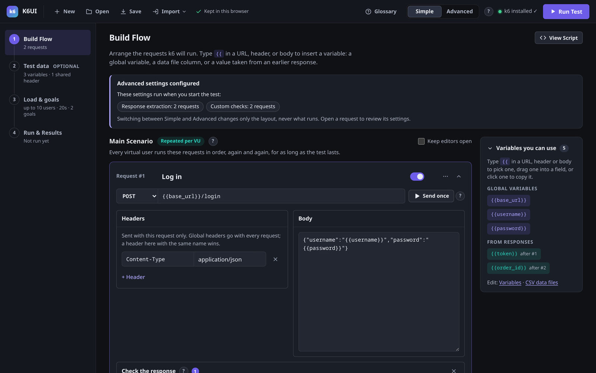
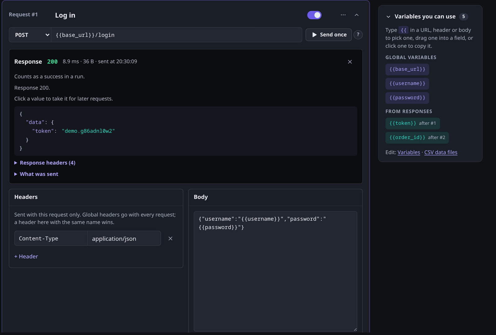
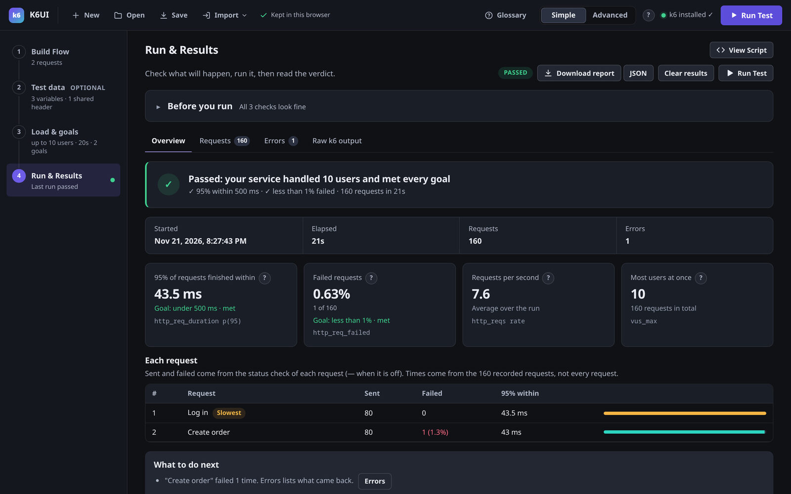
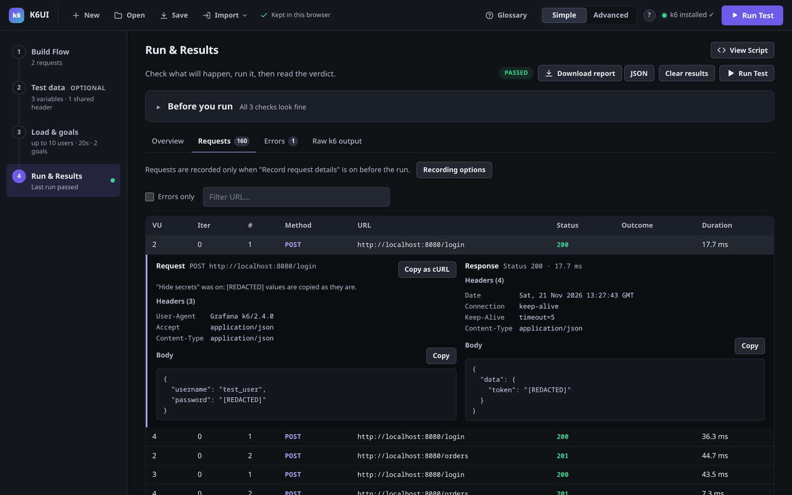
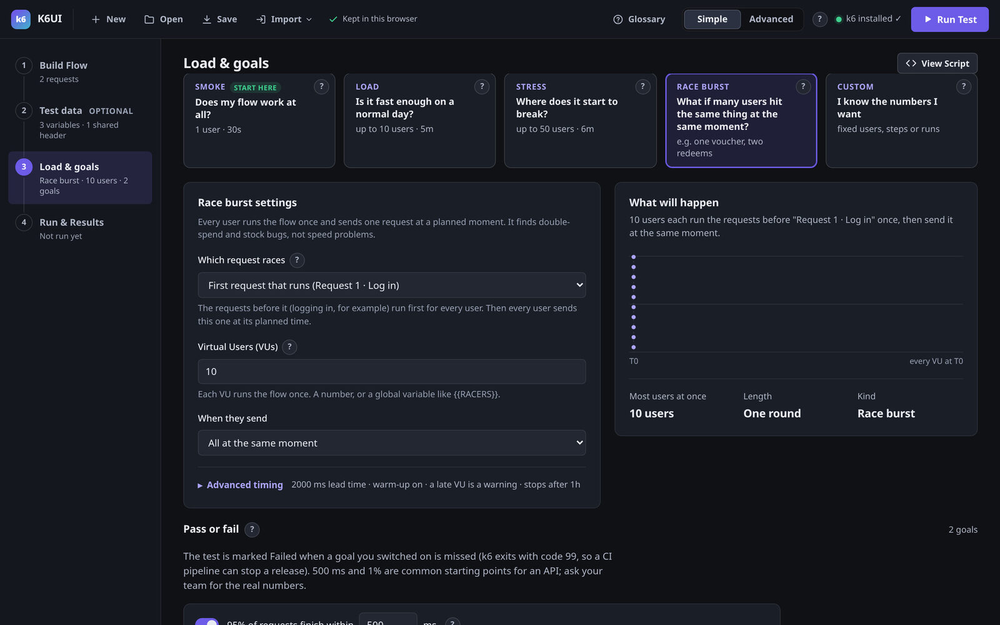
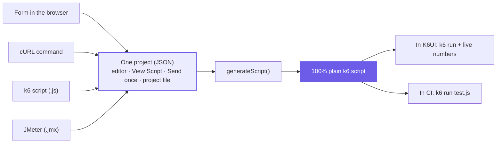
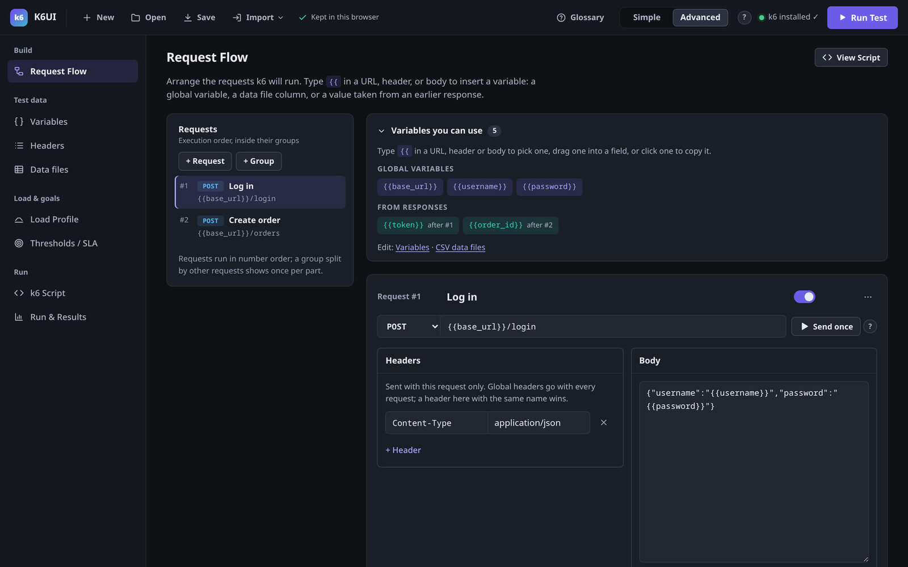
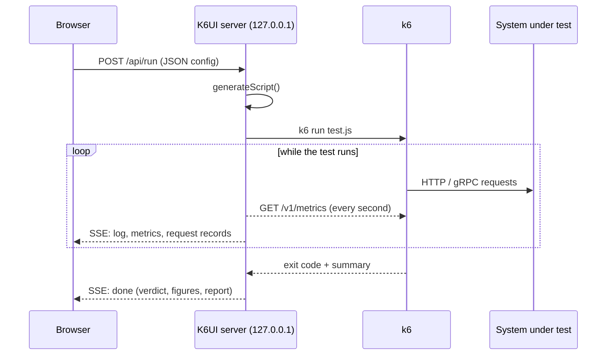

<div align="center">


# K6UI

**Build k6 load tests in a UI. The real k6 binary still runs them.**

Arrange requests the way you would in Postman, pick a load, click Run, and read the verdict in plain words.<br>
No JavaScript from scratch, and every test is a plain k6 script you can take to CI.

[](LICENSE)
[](https://nodejs.org)
[](https://k6.io/docs/get-started/installation/)
[](package.json)
[](#tech-stack)

[Quick start](#quick-start) · [Features](#features) · [Race burst](#race-burst-test-race-conditions) · [Performance](#performance) · [How it works](#how-it-works) · [Security](#security)

<br>



</div>

<br>

| **40,726 req/s** | **+33%** | **5.3× less memory** | **100% k6** |
|:---:|:---:|:---:|:---:|
| on par with a hand-written k6 script (40,429) at 50 users | more throughput than Apache JMeter on the same machine | 155 MB against JMeter's 821 MB | plain script, no lock-in, runs in any pipeline |

<sub>Benchmark setup and full numbers: [Performance](#performance).</sub>

## Why K6UI

Load test scenarios are many, and they change whenever the API does.

- **k6** is fast and light on memory, but every scenario is a script. Each time a test case changes, the script has to change with it.
- **JMeter** has a GUI, which is why many teams stay on it. But it is slower, uses far more memory, and a `.jmx` file is long XML that is hard to review.

K6UI takes the best of both: you build the test in a UI, and k6 runs it.

<details>
<summary><b>Without K6UI</b>, you write this by hand for every test case</summary>

```js
import http from "k6/http";
import { check } from "k6";
import { SharedArray } from "k6/data";
import papaparse from "https://jslib.k6.io/papaparse/5.1.1/index.js";

// test data
const users = new SharedArray("users", () =>
  papaparse.parse(open("./users.csv"), { header: true }).data);

// threshold
export const options = { thresholds: { http_req_duration: ["p(95)<500"] } };

export default function () {
  const res = http.post(`${BASE}/login`, JSON.stringify(user), params);
  // assertion
  check(res, { "status 200": (r) => r.status === 200 });
  const token = res.json("data.token");
  // ...then the next request, for every test case
}
```

</details>

## Features

<table>
<tr>
<td width="33%" valign="top">

**Postman-like editor**

URL, headers and body per request, arranged into one flow. *Send once* fires a single request, and a click on a JSON value turns it into `{{token}}` for later requests.

</td>
<td width="33%" valign="top">

**Beginner friendly**

Simple mode is four steps, with Smoke, Load and Stress presets ready to go. A **?** beside every term and a searchable glossary explain the jargon.

</td>
<td width="33%" valign="top">

**Flexible when you need it**

Advanced mode: CSV data files, outcome rules, conditional groups, gRPC, and pre/post-processor scripts.

</td>
</tr>
<tr>
<td valign="top">

**Reports anyone can read**

A verdict in one sentence, key numbers refreshed every second, every request with *Copy as cURL*, and a single-file HTML report.

</td>
<td valign="top">

**Race burst**

Every virtual user fires one request in the same millisecond, to find double-spend and oversold-stock bugs a normal load test never shows.

</td>
<td valign="top">

**Migration & CI/CD**

Import a cURL command, a k6 script or a JMeter `.jmx`. The generated k6 script runs in CI without K6UI.

</td>
</tr>
</table>

### Build like Postman, run with k6



1. Fill in the URL, headers and body, then press **Send once**. The request goes out through real k6 (1 VU × 1 iteration), exactly as it would in a run: global variables, the first CSV row, group headers and the pre-processor included.
2. Click a field in the JSON response. K6UI writes the selector for you: `data.token`.
3. `{{token}}` is now a variable for every request after it. The **Variables you can use** panel shows each variable and where it comes from.

### A verdict for the PM, the details for the engineer



- The first sentence says whether the test passed or failed, and which goals were met.
- p95, error rate, requests per second and virtual users update every second while the test runs.
- Open any request in full (headers and bodies) and copy it as cURL. **Hide secrets** redacts passwords, Bearer tokens and cookies inside k6, before anything leaves the script.
- Download the report as one HTML file (no scripts, prints to PDF) or as JSON.

<details>
<summary><b>See a recorded request</b></summary>
<br>

</details>

### Race burst: test race conditions

Hundreds of virtual users fire in the same millisecond. Use it to test double-spend holes, or stock that runs over during a flash sale: bugs that a normal load test never shows.



```text
        █ earlier requests (log in)    ▒ warm-up    · wait    │ T0    █ race request

VU 1    ██████████ ▒▒ ····················│ ████
VU 2    ██████████████ ▒▒ ················│ ██████
VU 3    ███████ ▒▒ ·······················│ █████
VU 4    ████████████ ▒▒ ··················│ ███████
VU 5    █████████ ▒▒ ·····················│ █████
                                          T0 = end of setup() + lead time
```

- **One clock.** T0 is computed once in `setup()` and shared with every VU, so they all aim at the same moment. Send them *together*, *spread* over a few milliseconds, or at your own offset per VU.
- **Warm connections.** A warm-up request opens the connection before T0: with 200 VUs, not one race request had to open a new connection.
- **Business results, not just errors.** Outcome rules tell a system error from an expected answer, such as a `400 QUOTA_EXCEEDED` once the quota is used up. A target like `success <= {{QUOTA}}` fails the run when too many got through.
- **See what happened.** The results show a timeline per VU, the spread from first to last send, the peak in flight and the tightest margin.

### Import what you have, ship plain k6



- When a threshold fails, k6 exits with code 99 and the CI/CD pipeline stops by itself.
- An imported `.js` script is read as a syntax tree and never run. The `.jmx` parser refuses DOCTYPE, so there are no external entities.

```bash
# View Script → Copy, commit it as test.js, then in the pipeline:
k6 run test.js   # exit 0 = every threshold met, 99 = a threshold failed
```

The script does not depend on K6UI: CSV data is embedded and helpers are written inline. Features that need the K6UI server (Save to CSV, request records, the race card) only write `console.log` lines that are safe to ignore.

## Performance

**On par with hand-written k6, 33% faster than JMeter.** K6UI writes a plain k6 script, so there is no extra runtime between your test and k6.

| 50 virtual users, no pause | K6UI | Hand-written k6 | JMeter 5.6.3 |
|---|---:|---:|---:|
| Requests per second | **40,726** | 40,429 | 30,558 |
| Requests per CPU second | **6,704** | 6,791 | 4,221 |
| p95 response time | **3.55 ms** | 3.59 ms | 4.0 ms |
| Memory (max RSS) | **155 MB** | 157 MB | 821 MB |

JMeter needs **5.3×** the memory of K6UI for the same load. Run through the K6UI server (live numbers on), the same flow reached 39,439 requests per second, within the noise of the hand-written script.

<sub>Intel Core Ultra 5 125U laptop, a local Go target on separate cores. Flow: log in, fetch a 4 KB product, add to cart. k6 v2.4.0, JMeter 5.6.3 with a 1 GB heap, median of 3 rounds, 21 November 2026. With 1,000 VUs and a 1 s think time every tool reaches the same throughput, but JMeter uses 2.8× the CPU time. Method and every number: [docs/baseline-performance.md](docs/baseline-performance.md).</sub>

> [!TIP]
> Comparing with JMeter at thousands of users? Use a ramp-up (the Load or Stress preset, or stages). k6 starts every VU in the same millisecond and a fixed pause keeps them in step, which inflates p95 (21–39 ms at 3,000 VUs, against JMeter's 1 ms on the same server). A 5 s ramp-up brought it down to 0.6 ms. This is how k6 schedules VUs, not a cost of the generated script.

## Quick start

**You need** [Node.js](https://nodejs.org) 18+ and [k6](https://k6.io/docs/get-started/installation/) on your `PATH` (k6 is only needed to run tests; script generation works without it; CSV data files need k6 0.38 or newer).

```bash
git clone https://github.com/zackyantoleo/K6UI.git
cd K6UI
npm install
npm start
```

Open http://localhost:3000. `PORT=8080 npm start` picks another port.

Your first test, in Simple mode:

1. **Build Flow**: add requests, or start from the *Log in, then use the token* template, a cURL command or an import.
2. **Test data** (optional): global variables, shared headers and CSV data files, used as `{{name}}`.
3. **Load & goals**: pick Smoke, Load, Stress, Race burst or Custom, then set pass/fail goals such as p95 and error rate.
4. **Run & Results**: check *Before you run*, click **Run Test**, and read the verdict.

Click **View Script** at any point to see the k6 script that will run.

## Simple and Advanced



A switch in the top bar picks the layout. Both show the same project:

- **Simple** (default): four steps (Build Flow, Test data, Load & goals, Run & Results). If a flow has settings that are not obvious at a glance (scripts, extraction, gRPC…), a notice lists them by category.
- **Advanced**: direct categories, plus a request outline next to the selected request's editor.

Switching never changes what runs or what is saved; the choice is remembered in your browser only. Details: [docs/ui-modes.md](docs/ui-modes.md).

## Everything it can do

<details>
<summary><b>Build the flow</b></summary>

- **Request flow**: one or many sequential requests (GET/POST/PUT/PATCH/DELETE/HEAD/OPTIONS) with headers and body, run in the order you arrange them.
- **Extraction & variables**: pull values out of responses (JSON path, header, or regex), then use them in later requests with `{{variable_name}}` in the URL, headers, or body (e.g. a login token). An extraction can have a **default** (for example `TOKEN_NOT_FOUND`), used when the response has no match (a missing JSON path or header, no regex match, or a body that is not JSON) instead of an empty or broken value.
- **Conditional groups ("Run only if")**: group requests and give the group a condition, for example `EXECUTION_MODE` *is one of* `ORDER_FLOW, ALL`. The variable can be a global variable, a data file column, or a value extracted by an earlier request, and it is read when the group starts. When the condition is false the whole group is skipped and the rest of the flow carries on; values the group would have extracted keep their default, or stay empty when they have none. Change the variable's value to choose which flow a run takes.
- **Per-request assertions**: validate status codes, body content, headers, or response time.
- **Success statuses**: the statuses that count as a success for one request, for example `200,400` in a race test where a 400 "quota reached" is the right answer. Only the other statuses count as failed requests.
- **Outcome rules**: give every response a label (the first rule that matches its status, a JSON path, a header or the body), count each label, and add targets such as `success <= {{QUOTA}}` to the pass/fail goals.
- **gRPC**: unary calls through server reflection (the target must support it), with metadata, checks and values taken from the response message.
- **Custom code**: optional JavaScript before and after a request, sharing a per-iteration `vars` object. It is syntax-checked when the script is generated and only ever run by k6.

</details>

<details>
<summary><b>Test data and load</b></summary>

- **Data files (CSV)**: give every iteration its own row from a CSV file (for example one login per user): choose a `.csv` file or paste its text, pick the delimiter, header row and column names, then use a column as `{{email}}` in any URL, header, or body. Rows are shared by all users (next row for every iteration) or fixed per user, and wrap around or stop when they run out. A data file can be tied to a group so its rows are only read when that group runs. The rows are written into the generated script, so View Script and standalone runs need no extra file; they are also saved in the project file, so keep credentials in mind. Up to 5 MB per file; running it needs k6 0.38 or newer.
- **Load profile**: fixed VUs + duration, staged (ramp up/down via stages), iterations (every VU runs the flow N times, then stops), or race burst (every VU sends one request at a planned moment). The Smoke, Load and Stress presets fill in a staged load for you.
- **Thresholds / SLA**: max p95 and max error rate targets; if unmet, k6 exits with a non-zero code (useful for CI/CD).

</details>

<details>
<summary><b>Run, results and reports</b></summary>

- **Script generation**: view & copy the generated k6 script; it can also be run standalone outside the UI.
- **Run & monitor**: k6 runs on the server; a verdict in plain words, key figures that update every second, live log streaming, a per-request detail table (filter by errors/URL, sort by any column, Copy as cURL), and an automatic metrics summary.
- **Save to CSV**: after a request, add a row to a CSV file of the run, for example `order_number` and `Bearer {{token}}` of every order that was created ("only when its extracted values were found" leaves out failed ones). After the run, **Run & Results** offers each file as a download or as a data file for a later run (such as a redeem flow that reads the orders). The rows stay in the browser tab only, never on the server, but they can hold tokens: treat the file like a password.
- **Download the run report**: after a run (or after you stop one), **Run & Results → Download report** saves one HTML page with the verdict, key figures, targets, checks, test setup, every k6 metric, and every recorded request with its payload and response (headers and bodies; turn on request recording under Run & Results → Requests first); it opens in any browser and prints to PDF. **JSON** saves the same report as data, with the full k6 summary. Global variables, data file rows, saved CSV values and the raw k6 output are left out; payloads and responses stay in (redacted only with "Hide secrets"), so treat the file like a password.

</details>

<details>
<summary><b>Projects, import and help</b></summary>

- **Save / open projects**: the configuration is saved as a JSON file and can be loaded back.
- **Nothing lost on refresh**: the project as you typed it is kept in this browser after every change and opens again on the next visit, so a refresh or a closed tab loses nothing ("Kept in this browser" in the top bar). **New** starts an empty project. The page only asks before you leave while a test runs (leaving stops it) or when the project is too big for the browser to keep (large CSV data files: use **Save**). The browser copy holds the same values as a project file, tokens and passwords included, and any other app you run on the same address (such as `localhost:3000`) can read it.
- **Import cURL**: **Import** in the top bar adds one request from a cURL command.
- **Import k6 scripts**: paste or open an existing k6 `.js` script and K6UI rebuilds the flow from it: load profile (including a single `per-vu-iterations` scenario), thresholds, requests, headers and bodies, `check()` assertions, values taken from responses, `sleep()`, and `group()`. The script is only read, never run. Anything K6UI cannot represent (loops, conditions, custom code, other `options`) is skipped and listed after the import. The one exception is the conditional block that K6UI itself writes for a "Run only if" group, which comes back as a group.
- **Import JMeter test plans**: paste or open a `.jmx` file in the same dialog. K6UI reads one thread group (users, ramp-up, duration — also Concurrency Thread Group; a fixed "N loops per user" becomes the iterations load mode, without ramp-up), HTTP requests with HTTP Request Defaults and Header Managers, User Defined Variables and `${__P(name,default)}`, Transaction/Simple Controllers as request groups, If Controllers with a readable condition (`EXECUTION_MODE`-style groovy checks, `${X} == "A"`) as groups with a "Run only if" condition, Response/Duration Assertions, JSON/Regex/Boundary Extractors (with their Default Value), and timers / Flow Control Action pauses. A CSV Data Set becomes a data file with its columns, header, delimiter and share mode; a `.jmx` does not contain the rows, so upload the CSV afterwards under Test data (a warning says which file). The file is only read, never run; anything else (logic controllers, scripts, other samplers) is listed after the import.
- **Help for people new to load testing**: a **?** next to a field or heading explains its term in plain words (point at it, focus it, or tap it). **Glossary** in the top bar lists every term, with a search box.

</details>

## How it works



1. The frontend reads the form into a single JSON configuration object. The same object is used by View Script, Run, Send once and the project file.
2. The server generates a k6 script from that configuration (`POST /api/generate`).
3. On run (`POST /api/run`), the server writes the script to a temporary folder, executes `k6 run`, reads k6's live numbers from its REST API once a second, and streams everything to the browser via Server-Sent Events; the temporary folder is removed afterwards.
4. The k6 exit code determines whether the thresholds/SLA were met (0 = pass, 99 = thresholds failed).

The browser never sends load itself: every request to the system under test comes from the k6 process.

### Tech stack

| Part | Choice |
|---|---|
| **Backend** | Node.js 18+ and Express (ES modules) |
| **Frontend** | Plain JavaScript modules: no framework, no build step |
| **Dependencies** | Two: `express` and `acorn` (to read imported k6 scripts) |
| **Load engine** | The real k6 binary, HTTP and gRPC |
| **Live numbers** | k6's REST API, streamed to the browser over Server-Sent Events |
| **Tests** | 70 files: `node:test`, runs with real k6, and Playwright browser checks |

<details>
<summary><b>Project structure</b></summary>

```
server/                 Express backend
├── index.js            Server entry point
├── routes.js           API endpoints
├── k6-runner.js        Runs the k6 process + streams its output
├── generator/          Turns the UI configuration into a k6 script
└── importer/           Reads a k6 script (or, in jmx/, a JMeter .jmx) into a UI configuration

public/                 Frontend (vanilla JS, no build step)
├── index.html          Markup for every view
├── css/                Styling: style.css lists the files (tokens, base, shell, components, flow, views)
└── js/                 One module per feature, components/ for DOM builders, shared/ for the pure
                        modules the server imports too (the only frontend code it may import)
```

Architecture notes, the configuration schema, and API details are in [CLAUDE.md](CLAUDE.md).

</details>

<details>
<summary><b>API</b></summary>

| Endpoint | Purpose |
|---|---|
| `GET /api/k6-status` | Check whether the k6 binary is available |
| `POST /api/generate` | Generate a k6 script from a configuration (up to 24 MB, so it can carry CSV data files) |
| `POST /api/run` | Run a test, results streamed via SSE |
| `POST /api/send-once` | Send one request through k6 (1 VU × 1 iteration) and return its response |
| `POST /api/import-script` | Read a k6 script into a configuration, with warnings for what was skipped |
| `POST /api/import-jmx` | Read a JMeter `.jmx` into a configuration, with warnings for what was skipped |

</details>

## Security

K6UI runs load tests and sends requests from the machine it runs on, and the pre/post-processor scripts of a project are JavaScript that k6 runs there. So by default it is reachable from that machine only:

- It listens on `127.0.0.1`, and it answers only requests addressed to `localhost` / `127.0.0.1` (any other `Host` gets a 403). That second check stops a web page from reaching it through DNS rebinding.
- Its API answers only K6UI's own page: a request a page on another site makes the browser send to `localhost` gets a 403 (`Sec-Fetch-Site` / `Origin`), and a POST that is not JSON (XML for a .jmx) gets a 415, so another site cannot start a run, even in a browser without `Sec-Fetch-Site`. At most 2 tests run at once.
- Text from a project (URLs, headers, checks, regexes, extraction names) is written into the script as data and never becomes code; only the pre/post-processor scripts are code (a .jmx never brings any). Open a project file from someone else only after reading its scripts.
- Imported k6 scripts are never executed, and the `.jmx` parser refuses DOCTYPE (no external entities).
- To share it on your network on purpose, start it with `HOST=0.0.0.0 npm start`. Then anyone who can open the page can run tests and send requests from your machine, including to services on your internal network. Only do this on a network you trust, behind your own authentication.
- Project files, the browser copy of a project, generated scripts and run reports hold variable values, headers and bodies as typed or recorded, tokens and passwords included. Treat them like the credentials they contain. **Hide secrets** keeps them out of request records and reports by redacting them inside k6.

## Development

```bash
npm run dev               # restart the server on file changes
npm test                  # Node's test runner; tests that need k6 skip when it is missing
npm run measure:baseline  # performance baseline, compare with docs/baseline-performance.md
```

More reading: [CLAUDE.md](CLAUDE.md) (architecture and configuration schema), [docs/project-schema-v2.md](docs/project-schema-v2.md), [docs/ui-modes.md](docs/ui-modes.md), [docs/baseline-performance.md](docs/baseline-performance.md).

## License

Copyright (c) 2026 zackyantoleo

K6UI is licensed under the [GNU Affero General Public License v3.0](LICENSE) (AGPL-3.0-only). You may use, modify, share, and sell it, as long as everyone you give it to, or who uses a modified version over a network, gets the complete source code of that version under the same license.

Want to use K6UI under other terms, for example in a closed-source product? Contact [zackyantoleo](https://github.com/zackyantoleo) about a commercial license.

Versions published before this change remain available under the MIT License.

K6UI is an independent project, not affiliated with or endorsed by Grafana Labs. k6 is a trademark of Grafana Labs.
